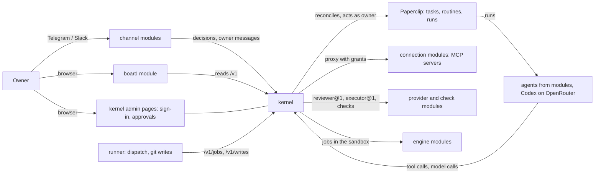

# Architecture

AidenHQ runs on one host. It is a small **kernel** plus **modules**. The kernel (`kernel/`, the systemd user unit
`aidenhq-kernel`) enforces: identity, grants, approval records and tiers, jobs, spend, accounts. Modules do the work:
agents, connections, engines, the AI reviewer, grading, the board, channels, the apps platform. Paperclip is the control
plane. Docker Compose runs Paperclip, the board and every module's containers; the kernel, the runner and the computer
launcher are systemd user units on the host.

Every agent call crosses the kernel twice at most: once at the tool proxy (`/c/<connection>/mcp`) and once at the model
gateway. Every write becomes a kernel record before anything happens.

## Components

For what each component adds over Paperclip, see [core-components.md](core-components.md). How a module declares its
part: [modules.md](modules.md).

**Kernel.** One host process with three loopback-or-backplane listeners: the backplane (`10.231.0.1:3130`: the tool
proxy, `/v1` for modules, the runner and the board), the admin listener (`127.0.0.1:3120`: sign-in and the approval
pages) and the gate's sign-in listener (`127.0.0.1:3129`), plus the model gateway (`8201`). Its parts:

| Part | Where |
|---|---|
| Caller identity and the tool proxy: grant check, tool tags, fencing, signed caller assertions | `kernel/src/identity.ts`, `proxy.ts`, `assert.ts` |
| Approval records and the write lifecycle (file, tier, review, decide, claim once, execute, outcome) | `kernel/src/records.ts`, `writes.ts`, `kinds.ts`, `reviews.ts` |
| The tier function, autonomy and routine caps | `kernel/src/tier.ts` |
| Engineer jobs and the sandbox (bwrap, namespaces, network jail) | `kernel/src/jobs.ts`, `sandbox.ts`, `netjail.ts` |
| The model gateway, spend caps and the ledger | `kernel/src/gateway/` |
| Accounts (password and TOTP) and the approval pages | `kernel/src/accounts.ts`, `admin.ts`, `signin.ts` |
| The finish gate (`task.finish` checks) | `kernel/src/checks.ts` |
| Channels: decision tokens, owner messages, the notify brake | `kernel/src/channels.ts`, `brake.ts` |
| Paperclip binding: reconcile, reads and agent actions for modules | `kernel/src/reconcile.ts`, `cp.ts` |
| The loader: authority diff, points, services, remote sources, advisories | `kernel/src/loader/` |

Restarts never interrupt agents: jobs run detached and the next kernel adopts them.

**Paperclip (control plane).** The source of truth for companies, agents, tasks, routines and run history. Its UI is
the fleet console. Agents run with the Codex adapter against OpenRouter through the kernel's gateway. The generated
`config/paperclip.yaml` is applied to it idempotently by `scripts/paperclip-setup.mjs`.

**Chief of staff and crews.** Aiden (the `chief-of-staff` module) is the single entry point: it reads widely and
delegates writes. Crews are specialist agents woken by schedules (Paperclip routines), events (routine webhooks) or the
runner. Every agent is a `module.yaml` entry plus an `AGENTS.md` handbook, so new behaviour is configuration and prose,
not kernel code. A `heartbeat: true` agent is also woken when work it waits on changes (a sub-task, an approval card, a
grade, a PR: the board's `wake.ts`) and, as a backstop, by a "Heartbeat: <key>" routine every `heartbeat_hours`
(default 4). This is not Paperclip's own heartbeat: Paperclip calls every agent run a "heartbeat run" and has a
per-agent heartbeat timer, which AidenHQ keeps off.

**Shared connections.** Each external system (Google, Slack, Glean, Jira, GitHub, Primer, Grafana, ClickHouse) is a
module whose MCP server holds one login, so credentials are connected once and never given to agents. Agents reach a
connection only through the kernel's proxy (`http://10.231.0.1:3130/c/<connection>/mcp`), which looks the tool up in the
manifest (read, write or destructive), checks the caller's grant in the grants table setup writes, routes writes into
records, and forwards reads with the connection's service key. Roles, declared by the modules that check them, gate a
few extra capabilities (for example the board's fleet tools, or changing any app with an open incident).

**Runner and Engineers.** The host runner (`services/runner`) picks up Paperclip tasks labelled `engineer` and
dispatches each as a kernel job (`POST /v1/jobs`; the `engineering` module holds `kernel.jobs`). The kernel runs the
engine an engine module provides (`engine-codex`, `engine-opencode`, `engine-claude`) in a sandboxed per-task workspace;
the Engineer gets a small `aidenhq` CLI ([design](design/conversational-engineers.md)). Each job runs under bwrap with an allowlist of the host's files (its
task folder, the toolchains, its engine's state), in its own PID, IPC and network namespaces (pasta).

| Engine | Harness | Model access | Effort |
|---|---|---|---|
| `codex-openrouter` (primary) | Codex CLI, its own sandbox, a runner-owned Codex home per task with the product's skills | OpenRouter through the model gateway, a per-job token, ZDR only | low to max (max: DeepSeek) |
| `codex` | Codex CLI, its own sandbox | the host's Codex login | low to xhigh |
| `claude` | Claude Code under bwrap | a subscription token | low to max |
| `openrouter` (fallback) | opencode under bwrap | OpenRouter through the model gateway, a per-job token | low to high (model variants) |

Every job gets Primer read-only. Private reads (Grafana, Slack, Glean, ClickHouse, gcloud, other tasks) go only to an
Engineer whose definition sets `private_reads: true`, on any engine, and such a job has no web search. See [the codex-openrouter design](design/codex-openrouter-engine.md). Pushes, pull requests and merges are checked in code: allowed
organizations only, branch and leak checks, a lease on rewritten branches, and a merge queue that requires approved,
green, mergeable PRs (the git rules are `codehost-github`'s). Each write is a kernel record: the runner proposes its tier
from verified state (`services/runner/src/tiers.mjs`), the kernel combines it with the kind's floor, autonomy and earlier
vetoes (`kernel/src/tier.ts`) and never lowers it. Tier 0 runs at once, the AI reviewer decides Tier 1, the owner decides
Tier 2; the tier is never taken from untrusted text.

**Apps platform (`modules/apps-platform`, `apps-mcp`).** Long-running services that agents deploy and maintain. The registry is the instance's
`apps.yaml` plus module apps. Each app runs sandboxed (no host access, no extra privileges) unless its registry entry
grants it; apps that keep data or declare restricted roles deploy only on the owner's approval. App secrets are files
mounted at `/run/secrets/<KEY>`, never environment variables. The DevOps Engineer owns app health.

**Preview deploys.** Each open pull request on an agents-org app's repo (into its deploy branch, from the same repo; the
newest three per app) also runs from its head as `<app>-pr-<n>`, on its own port on the apps' tailnet node, and the PR
gets one comment with the URL ([previews.ts](../modules/apps-platform/apps-mcp/src/previews.ts)). Nothing waits on a preview: merges
and production deploys are unchanged, and previews run in their own loop. PR heads are unmerged code, so a preview gets its
own empty warehouse schema and login (never the live schema; the app's migrations run there), a random placeholder for
every other secret, and no connections but the warehouse. It is removed with everything it had (containers, volumes,
images, schema, secrets) when the PR closes or merges. A shared app's preview is at `https://pr-<n>.<share.host>` through
the gate, with the app's own Access audience and roles, once `settings.edge.previews` is on ([access](design/access.md)).

**Warehouse.** A shared Postgres app (`modules/warehouse`) that sources and apps ingest into, with a read-only role for
consumers.

**Board.** The owner's daily surface (the `board` module, served by `services/board`): today's tasks, chats with
agents, the Approvals page, connections, apps and the fleet. Approvals are kernel records; the board lists them from the
kernel's `/v1` and links each card to the kernel's own page, where a signed-in admin decides it (or the owner channel, or
an exact typed reply). Each is claimed once and the outcome is shown on the card.

**Owner channels.** `channel-telegram` (the Telegram owner bot, in the default bundle) and `channel-slack` (optional: one
Slack Socket Mode listener) bridge the owner to Aiden and provide `notify_owner`, the way agents reach the owner.
`chat-lane` is the fast chat lane. Approval cards are decided with per-card, per-channel,
single-use decision tokens that the kernel mints (bound to the card's digest) at `/v1/channel/cards` and
`/v1/channel/decide`. Owner messages from a channel go through the kernel's `/v1/channel/owner-message`; only the
kernel holds the Paperclip board key.

**Agent computers (`services/computer`).** Optional per-agent isolated containers for runs, started by a launcher that
issues each run a token. Off unless an agent definition sets `image:`.

**Secret vault.** The secrets directory is an encrypted gocryptfs view, unlocked at boot with a TPM-sealed password
([ops/vault/README.md](../ops/vault/README.md)).

## Configuration flow

`modules/` (product), any third-party marketplaces and the instance repo (yours) compile into `config/paperclip.yaml`,
`config/apps.modules.yaml`, `compose.modules.yaml` (every module's containers, generated from `services:`),
`config/kernel/*.json` (modules, write kinds, checks), `config/points/<module>.json`, `config/modules.json` and
`config/computers.json`. Compose runs the services, setup applies the Paperclip config and writes the grants table, and
the kernel rereads its files. Each module change is tiered by its authority diff before the apply runs. See
[configuration.md](configuration.md) and [modules.md](modules.md).

## Trust and data boundaries

- **Inbound is private.** Every listener binds loopback or a private backplane; the front door the `exposure` setting picks
  (Tailscale by default) is the only way in, and Paperclip runs in authenticated mode. Outbound traffic is not restricted.
- **Untrusted text is data.** Slack messages, email, forwards and documents are fenced and never act as instructions.
  Admin actions run only on the owner's own words.
- **Gates live in code.** Tool grants, push and merge gates, approvals and deploy rules are enforced below the model.
  No agent holds the token that decides an approval.
- **Approvals are records.** Pushes, PRs, merges, fleet changes, module changes, app deploys and every write tool are
  kernel approval records, tiered by code (Tier 2 is the owner's tap); an agent's change to its own configuration lands in the instance repo only through
  one.
- **Separation of config.** Product code and handbooks live in the product repo; per-deployment choices live in the
  private instance repo; secrets live only in the vault; host paths stay in the host `.env`, never in
  `instance.yaml`, which agents may edit through an approved change.
- **Nothing is sent as the owner.** Agents post as a labelled bot or leave drafts the owner sends.
