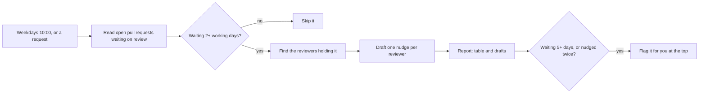

What this is: the design of a new agent, Review Chaser, which chases pull requests waiting on someone's review.
What's needed from you: review it. Edit anything directly, comment on any line, and say **ready** in a comment or in chat when it's right.
If nothing happens: it waits. Nothing is built until you say ready.

# Review Chaser

> Chases pull requests that wait on a review for two working days or more, and drafts a friendly nudge for each reviewer.

## At a glance

| | |
|---|---|
| **Name** | Review Chaser (or: Rex, Nudge) |
| **On your team as** | Review Chaser · Chases PR reviews |
| **What you'll see from it** | "3 PRs wait on review; nudges drafted for 2 reviewers." |
| **Its face** | Short hair, headset, palette 5 (change it on its page) |
| **Its job** | Finds pull requests waiting on review and drafts a nudge for whoever holds each one |
| **What wakes it** | Its weekday schedule, or a request ("chase the reviews on acme/api") |
| **Schedule** | Weekdays at 10:00 |
| **Reports to** | Aiden |

## How each run works

In words:

1. It wakes on its weekday schedule, or when someone asks it to chase a repository.
2. It reads the open pull requests that have a review requested and none given for 2 working days or more.
3. For each, it finds the reviewers who haven't reviewed, and skips one nudged in the last 2 working days.
4. It drafts one short nudge per reviewer, with all their pull requests in it.
5. It reports a table (pull request, reviewer, waiting since) with the drafts below it.
6. A pull request waiting 5+ working days, or a reviewer nudged twice, is flagged for you at the top.

## What it can read and change

| | |
|---|---|
| **Reads** | GitHub pull requests and reviews; Slack, to see earlier nudges |
| **Changes** | Its nudges, as Slack drafts you send |
| **Contacts** | Nobody: you send each nudge |

## Schedule and cost

| Runs | Each run | A month |
|---|---|---|
| Weekdays at 10:00 (about 22 a month) | about $0.10 | about $2.20 |

## Onboarding plan

1. It reproduces the three examples below correctly.
2. Then it works real weekdays in batches of five runs, each report reviewed by the Agent Architect.
3. It runs on its own after two clean batches in a row.

## Examples

| # | What happens | A good result |
|---|---|---|
| 1 | A pull request in acme/api has review requested from two engineers 3 working days ago; one approved | One row, for the engineer who hasn't reviewed, with a nudge naming that pull request |
| 2 | A draft pull request had review requested a week ago | Skipped (draft), listed with the reason |
| 3 | The reviewer was nudged in Slack yesterday | Skipped ("nudged yesterday"), no new draft |

## Open decisions

| Decision | Recommended | Other choice |
|---|---|---|
| How long before chasing | **2 working days**: catches stuck reviews without nagging | 1 working day |
| Where nudges go | **A Slack DM to the reviewer**: personal, easy to act on | A comment on the pull request |
